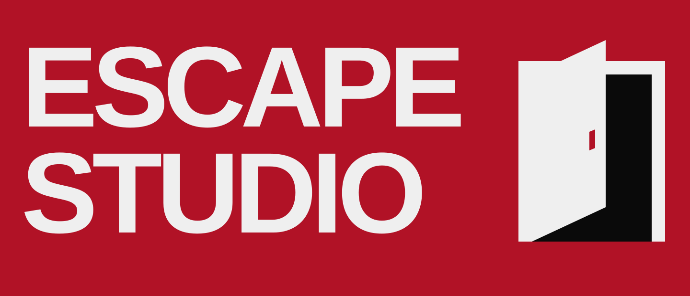

  

**Software experiments in agents, interfaces and interactive worlds.**

I build things to find out what they can become.

### Selected work

<table>
  <tr>
    <td width="50%" valign="top">
      <h3><a href="https://github.com/antropos17/Aegis">AEGIS</a></h3>
      
Windows-first agent monitoring, local security reviews and opt-in controls.

    </td>
    <td width="50%" valign="top">
      <h3><a href="https://github.com/antropos17/commit-zero">Commit Zero</a></h3>
      
A local agent commons for chat, code review and language-and-game experiments.

    </td>
  </tr>
</table>

### Off the main path

[The AI Museum](https://github.com/antropos17/theaimuseum) — an interactive history of AI. 
[Persona Vault](https://github.com/antropos17/PersonaVault) — an AI persona registry experiment. 
[BugCam](https://github.com/antropos17/ai-cam) — Unity scene repeatability experiments. 
[FindBuild](https://github.com/antropos17/build_demo1) — a construction-material marketplace prototype.

[All repositories →](https://github.com/antropos17?tab=repositories)
