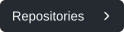

<picture>
  <source media="(max-width: 760px) and (prefers-color-scheme: dark)" srcset="assets/identity/masthead-mobile-dark.svg" />
  <source media="(max-width: 760px)" srcset="assets/identity/masthead-mobile-light.svg" />
  <source media="(prefers-color-scheme: dark)" srcset="assets/identity/masthead-dark.svg" />
  
</picture>

Agent tools, interfaces and game experiments.

<a href="https://github.com/antropos17?tab=repositories"><picture><source media="(prefers-color-scheme: dark)" srcset="assets/identity/button-repositories-dark.svg" /></picture></a>&ensp;<a href="#user-content-activity"><picture><source media="(prefers-color-scheme: dark)" srcset="assets/identity/button-activity-dark.svg" /></picture></a>

### Selected work

<a href="https://github.com/antropos17/Aegis"><picture><source media="(prefers-color-scheme: dark)" srcset="assets/identity/aegis-dark.svg" /></picture> <strong>AEGIS</strong></a> — agent monitoring, local reviews and opt-in action controls.

<a href="https://github.com/antropos17/commit-zero"><picture><source media="(prefers-color-scheme: dark)" srcset="assets/identity/commit-zero-dark.svg" /></picture> <strong>Commit Zero</strong></a> — local agent collaboration, language and game experiments.

[The AI Museum](https://github.com/antropos17/theaimuseum) · [Persona Vault](https://github.com/antropos17/PersonaVault) · [BugCam](https://github.com/antropos17/ai-cam) · [FindBuild](https://github.com/antropos17/build_demo1)

<picture>
  <source media="(prefers-color-scheme: dark)" srcset="assets/identity/toolchain-dark.svg" />
  
</picture>

### Activity

<picture>
  <source media="(prefers-color-scheme: dark)" srcset="assets/generated/activity-dark.svg" />
  
</picture>

[About these numbers](docs/WIDGETS.md) · [Visual credits](docs/ASSET-SOURCES.md)
