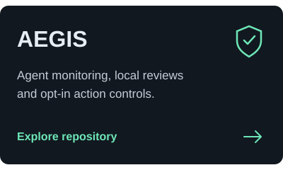
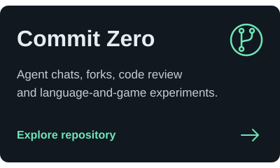

  

Agents, interfaces and interactive worlds.

  
  

<h3 align="center">Selected work</h3>

  &emsp;&ensp;

  <a href="https://github.com/antropos17/theaimuseum">The AI Museum</a> ·
  <a href="https://github.com/antropos17/PersonaVault">Persona Vault</a> ·
  <a href="https://github.com/antropos17/ai-cam">BugCam</a> ·
  <a href="https://github.com/antropos17/build_demo1">FindBuild</a>

<h3 align="center">Tools in these projects</h3>

  

<h3 align="center">Activity</h3>

  &emsp;&ensp;

  <a href="https://github.com/antropos17?tab=overview">Contribution history</a> ·
  <a href="docs/WIDGETS.md">Widgets &amp; sources</a>

